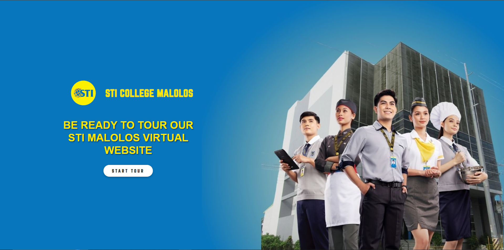
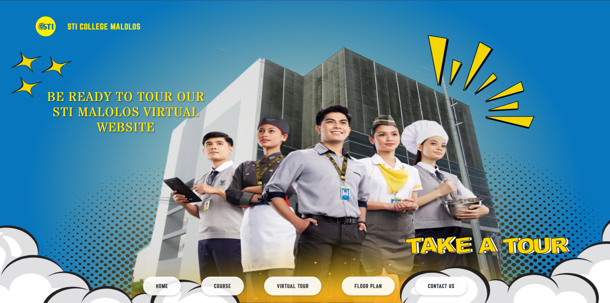
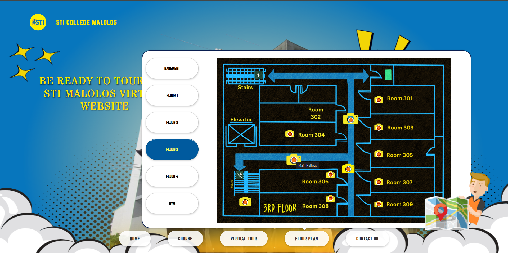
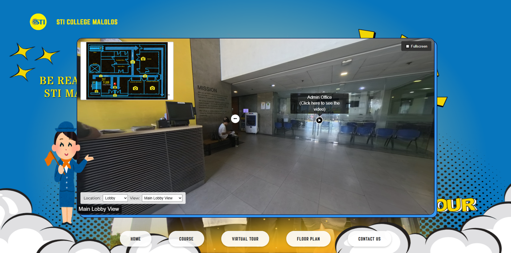

# STI College Malolos — Virtual Campus Tour

**An interactive 360° campus tour website that lets prospective students explore the school from anywhere.**

---

## Overview

The STI College Malolos Virtual Tour is a client project that brings the campus to the browser. Visitors can walk through the school in 360° panoramas, jump between floors using an interactive floor plan, and get to know the facilities before ever stepping on campus.

The main feature is the **360° virtual tour**, built with **Pannellum**.

---

## Screenshots

### Landing Page

### Home

### Interactive Floor Plan

### 360° Virtual Tour

---

## Features

**360° virtual tour** (main feature)
- Fully explorable panoramic views: drag to look around, zoom in and out
- **Location** and **View** dropdowns to jump between areas (e.g. Lobby → Main Lobby View)
- Built-in **mini floor map** showing where you are
- **Interactive hotspots** inside the panorama (e.g. click the Admin Office marker to play a video)
- Fullscreen mode for a more immersive experience

**Interactive floor plan**
- Floor selector covering the **Basement, Floors 1 to 4, and the Gym**
- Clickable camera markers on each room (e.g. Rooms 301 to 309), with stairs, elevator, and main hallway labeled
- Floor plans link directly to the corresponding 360° views

**Website experience**
- Landing page with a **Start Tour** call to action
- Home page with a bold, playful theme and an animated tour guide mascot
- Easy navigation: **Home, Course, Virtual Tour, Floor Plan, Contact Us**
- Responsive, lightweight static site: no backend needed

---

## Tech Stack

| Layer | Technology |
|---|---|
| Structure | HTML5 |
| Styling | CSS3 |
| Logic & interactivity | JavaScript |
| 360° panorama viewer | [Pannellum](https://pannellum.org/) |

---

## Source Code

This is a **client project**, so the source code is private and not publicly available. This repository is a showcase of the system only.

If you'd like to know more about how it was built, feel free to reach out through my GitHub profile: **[github.com/jhaylm-dev](https://github.com/jhaylm-dev)**.

---

## Author

**Jhay Landrei Marcelino**: Full-Stack Software Developer (Flutter, Dart, Go, Python, C#/.NET) based in Laguna, Philippines.

---

## Notes

Screenshots use sample/demo data. This repository is a portfolio showcase of a client project; the source code is not included.

© 2025 STI Malolos College Tour. All rights reserved.
